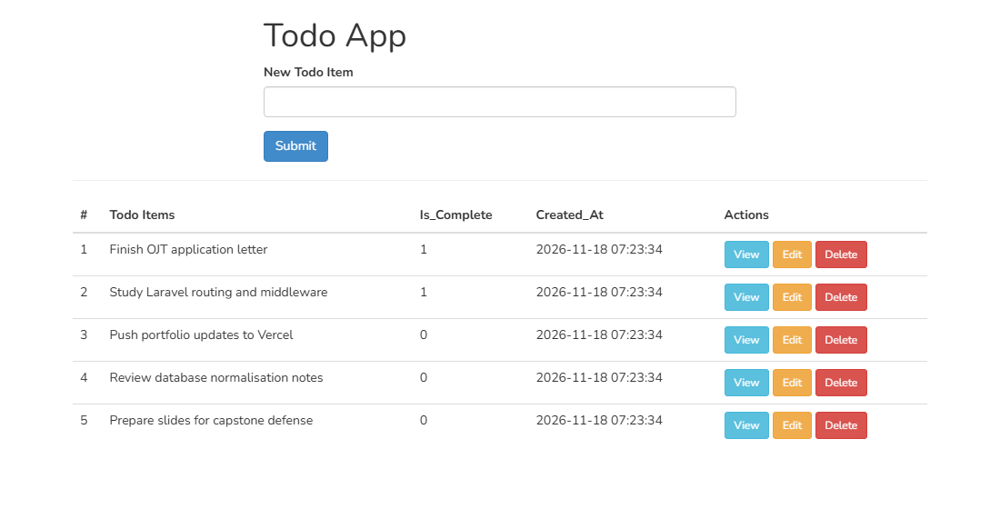
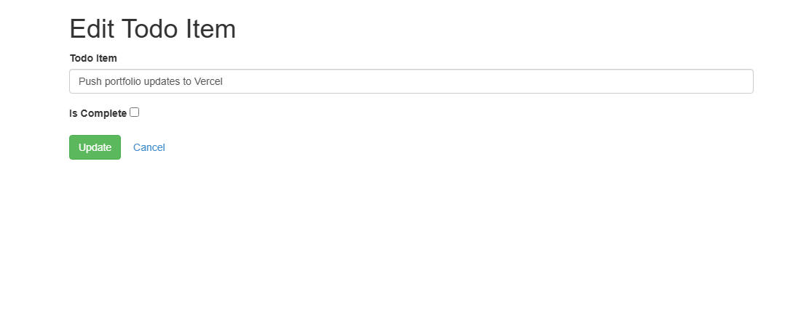

# Todo App — Laravel

A small CRUD to-do list: add an item, view it, edit it, mark it complete,
delete it. I wrote it to learn Laravel's MVC pieces end to end — an Eloquent
model, a controller, named routes, Blade templates and a migration — without
leaning on `make:resource` scaffolding.





## Running it

You need PHP 8.3+ and Composer. SQLite is the default database, so there is
nothing to install or configure.

```bash
git clone https://github.com/adrielleestacio/to-do-list.git
cd to-do-list
composer install
cp .env.example .env
php artisan key:generate
touch database/database.sqlite
php artisan migrate --seed
php artisan serve
```

Then open <http://localhost:8000>. `--seed` puts five rows in so the table is
not empty on the first run; drop it if you would rather start blank.

To use MySQL instead, set `DB_CONNECTION=mysql` and the usual `DB_*` values in
`.env` and run `php artisan migrate` again.

## How it is put together

| Path | What it holds |
| --- | --- |
| `routes/web.php` | Six named routes, one per action. |
| `app/Http/Controllers/TodoListController.php` | All six actions; no business logic lives in the views. |
| `app/Models/TodoList.php` | The Eloquent model — `TodoList` maps to the `todo_lists` table by convention. |
| `database/migrations/…_create_todo_lists_table.php` | `id`, `name`, `is_complete`, timestamps. |
| `resources/views/welcome.blade.php` | The list screen and the new-item form. |
| `resources/views/layouts/app.blade.php` | The shell the view and edit screens extend. |
| `resources/views/flash-message.blade.php` | One partial that renders every alert type from the session. |

### Routes

| Method | URI | Action |
| --- | --- | --- |
| GET | `/` | list every item |
| POST | `/saveItem` | create |
| GET | `/viewItem/{id}` | show one |
| GET | `/editItem/{id}` | edit form |
| POST | `/updateItem/{id}` | update |
| POST | `/deleteItem/{id}` | delete |

Deleting is POST rather than GET on purpose. A `GET` delete link can be
followed by a crawler, a browser prefetch or anything that walks the page, and
the row disappears without anyone clicking. The form carries a CSRF token like
every other write.

## Notes

Originally written against Laravel 8 for a class exercise; the app code is
unchanged apart from bug fixes, but it now runs on a current, supported
Laravel release so `composer install` works without pulling an end-of-life
framework.

## Built with

Laravel · PHP · Blade · Eloquent · SQLite (MySQL optional) · Bootstrap
